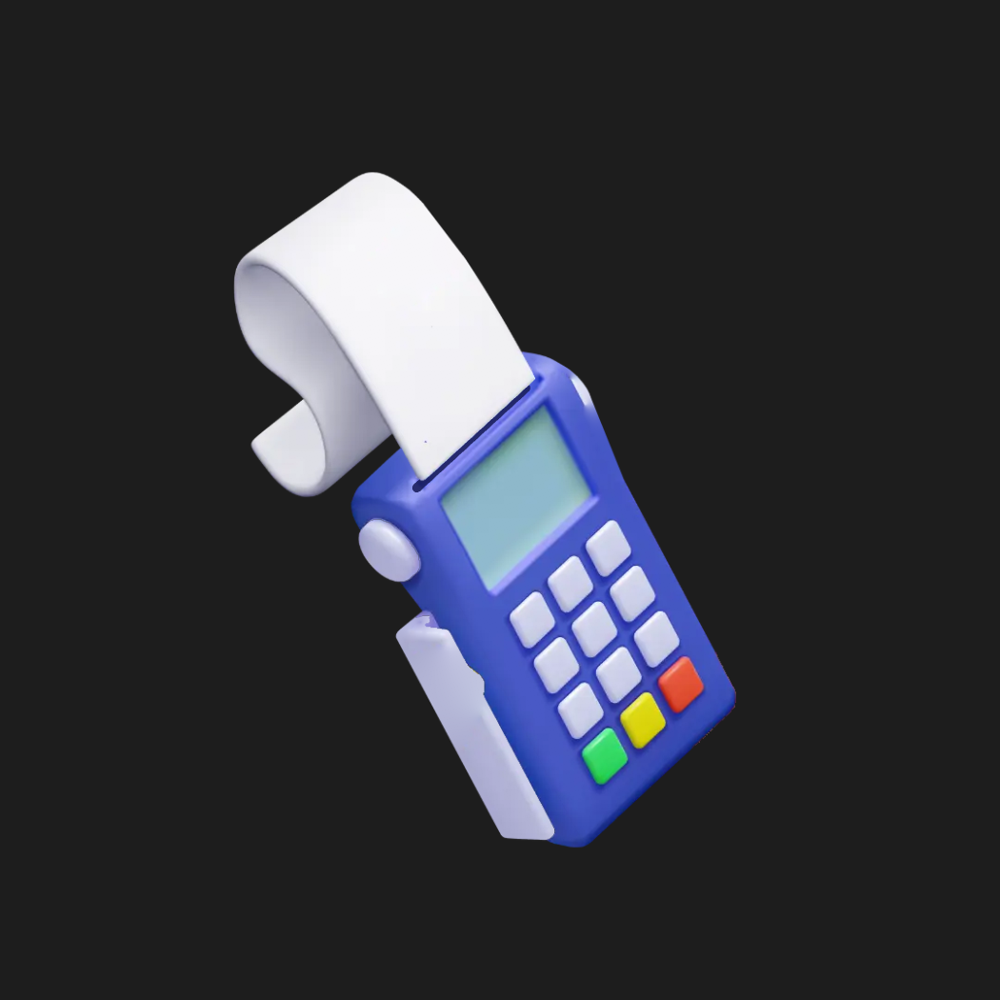

# Tamiaki POS printing animation

The "printing in progress" illustration from the Emblem Tamiaki cash register
screen (Figma: *Cash Register Screen → State 3 — Printing in progress →
Illustration/printing (layered)*), animated in Rive. The POS prints a receipt
that feeds out of its slot until the app says printing is done. Built entirely
with the Rive CLI, no editor.

**Use `dist/pos_printing.riv`.**



## What it does

| | |
|---|---|
| Artboard | `PosPrinting`, 350 × 350, transparent |
| State machine | `printing` (the artboard default) |
| View model | `PosPrinting`, one boolean: `isPrinting` (default `true`) |

- **`isPrinting = true`:** `intro` (0.4 s fade and settle), then
  `printing_loop` (2.5 s). Each cycle, the receipt feeds out of the slot in
  four motor steps, holds, lifts and fades as if torn off, and two keys are
  pressed for the next one.
- **`isPrinting = false`:** the current cycle finishes, then `done` feeds the
  receipt out in one glide and holds in the exact Figma pose, with a green-key
  confirm.
- **`true` again** restarts from `intro`.

See `previews/` for frame strips of each path, and
`integration/PosPrintingAnimation.tsx` for a React Native example.

## Layout

```
pos_printing/        Rive CLI project: scene.rml is the whole animation
  assets/            layer images used by the scene
dist/                built .riv to ship
reference/
  figma_illustration.png   Figma's own render, for comparison
  layers/                  untouched Figma layer exports
tools/
  patch_holes.py     asset prep (see below)
  runtime-check/     plays the .riv in the stock Rive runtime and asserts behaviour
  contact_sheet.py   tiles frames into the previews
integration/         React Native example
previews/            frame strips from headless renders
```

## Building

```bash
curl -fsSL https://releases.rive.app/cli/install.sh | sh   # once
cd pos_printing
rive . --verify && rive inspect . --summary                # check
rive . --once && cp build/pos_printing.riv ../dist/        # build
rive .                                                     # live preview window
cd ../tools/runtime-check && npm install && node check.mjs # behaviour test
```

Publishing to a Rive account, or exporting an editable `.rev`, needs a login.
See [PUBLISHING.md](PUBLISHING.md).

## Asset notes

- The layers are the original 1080 px cutouts from Figma, shown at 350/1080
  scale, so they stay sharp at 3× pixel density.
- The coins are dropped as requested. The cutouts had holes wherever another
  layer sat in front: the paper and stand where coins covered them, and the
  POS body where the paper covered it. `tools/patch_holes.py` fills each hole
  by extending the layer's outline and blending colour in from the surrounding
  pixels. It reads `reference/layers/` and writes `pos_printing/assets/`. A
  re-export of those three layers from the 3D source, without the occlusion,
  would be cleaner still.
- The dark slot line under the receipt is a Rive shape, not part of the Figma
  art. It is what the paper feeds out of.
